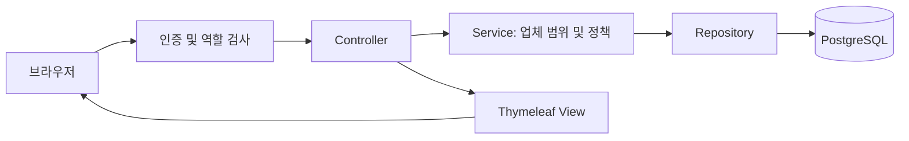
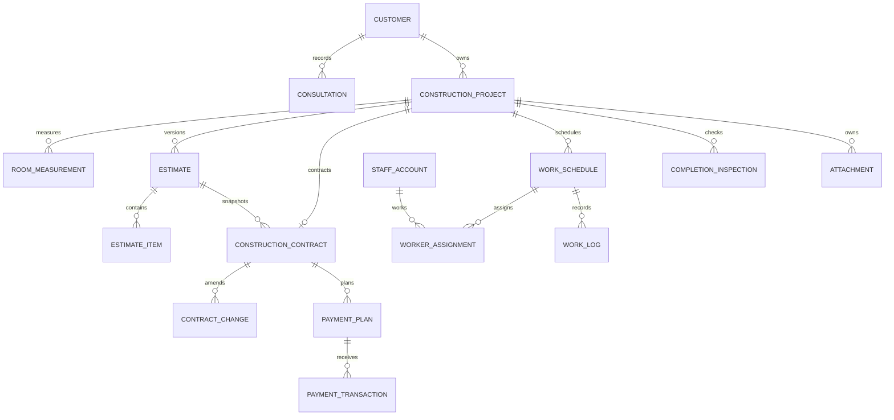

# 아키텍처와 데이터 관계

## MVC와 패키지 원칙

도메인별 패키지 안에서 `controller`, `dto`, `service`, `repository`, `model`을 구분합니다.
`controller`는 HTTP와 화면 전환, `service`는 트랜잭션과 정책, `repository`는 DB 조회를 담당합니다.
`model`의 JPA Entity가 저장 모델이며 Thymeleaf 템플릿이 View입니다.
기능이 아직 없는 패키지에는 의미 없는 빈 Service를 만들지 않았습니다. 개발할 때 화면의 정책 단위로 추가하세요.

## 데이터 관계

## 공통 저장 규칙

- 모든 Entity에 `id`, `companyId`, `version`, `createdAt`, `updatedAt`을 둡니다.
- 시간은 `Instant`와 UTC DB 연결을 사용합니다. 일정 화면 입력·출력 구현 시 `Asia/Seoul`로 변환하세요.
- PostgreSQL FK는 `(company_id, 참조ID)`로 연결하여 타 업체 데이터를 잘못 연결하지 못하게 합니다.
- JPA 모델은 참조 ID를 명시적으로 사용합니다. 관계 객체의 자동 로딩으로 권한 밖 데이터가 뷰에 노출되는 것을 피하고 서비스에서 범위를 검증합니다.
- 현재 하나의 업체 ID를 초기 설정에서 생성 계정에 부여합니다. 멀티 업체 가입·전환 기능은 없습니다.
- 금액은 `Long` 원 단위, 수량과 실측은 `BigDecimal`입니다.
- 신규 고객·현장의 요청 키는 UUID 고유키입니다. 수정은 클라이언트 버전과 JPA 낙관적 잠금을 검사합니다.
- 모든 POST는 CSRF 검증을 유지합니다. 직접 URL에도 관리자·사무·작업자 권한 검사를 적용합니다.
- 기존 세션도 계정의 활성 상태·역할을 요청마다 DB와 비교합니다.

## 후속 기능에서 유지할 정책

- 확정 견적 수정 대신 새 버전 생성. 계약은 확정 당시 원본 버전과 회사·항목 스냅샷을 보존.
- 계약 이후 금액 변화는 `ContractChange`에 증감액 기록.
- 수금은 `PaymentTransaction` 원장에 입금·환불·취소 역거래로 기록하며 원본을 삭제하지 않음.
- 작업자 배정 충돌 계산은 `ScheduleConflictPolicy` 사용. 저장 시 작업자별 잠금으로 동시 요청의 경합도 차단.
- 작업자 조회는 본인 배정 여부를 매 요청 검증. 작업용 DTO에 금액·다른 현장·원가를 포함하지 않음.
- 완료 승인과 완납은 별개. 완료 점검 후 미해결 이슈를 확인하고 관리자만 승인.
- 저장 변경 시 `AuditEvent` 작성. 현재는 모델만 있으며 실제 감사 기록 생성은 후속 작업.
- 파일 저장 키와 원본 파일명을 분리하고 로그인·배정 권한을 확인하는 다운로드 경로 사용. 현재 업로드·다운로드 경로는 없음.
- 관리자 설정에 마지막 활성 관리자 보호와 비활성화 시 미완료 배정 재지정 정책 추가.

## DB 마이그레이션

`V1__create_initial_schema.sql`에 23개 테이블과 업체 범위 FK가 있습니다.
실제 DB에 적용한 이후에는 V1을 수정하지 말고 `V2__설명.sql` 등 다음 마이그레이션을 추가하세요.
`demo`는 메모리 DB와 Hibernate 자동 생성이며, `test`는 동일 Flyway SQL을 적용합니다.
운영은 Flyway 적용 후 JPA `validate`로 확인합니다. 실제 PostgreSQL 검증은 연결 정보가 준비된 뒤 진행하세요.
